# Entity Relationship Diagram (ERD) — Sistem HRIS & Payroll
## Dokumen Pendamping PRD & Payroll Engine Spec

**Versi:** 1.1
**Tanggal:** 17 November 2026
**Database:** PostgreSQL

### Riwayat perubahan v1.1
- RBAC: user bisa punya banyak role (`user_roles`); user tidak wajib terhubung ke karyawan (misal Super Admin).
- `departments.head_employee_id` untuk approver `department_head`.
- `leave_requests.workflow_id`; enum `request_type` ditambah `overtime`; delegasi approver.
- `payroll_periods` mendukung run reguler, THR/bonus, dan koreksi.
- Rincian BPJS per program & premi kena pajak di `payroll_details`; `payroll_components` jadi sumber rincian.
- Tabel baru: `user_roles`, `company_settings`, `work_locations`, `shift_schedules`, `salary_components`, `employee_salary_components`, `employee_loans`, `loan_installments`, `tax_year_summaries`, `pph21_progressive_rates`, `approval_delegations`.
- Kolom karyawan baru: jenis kelamin, agama, tanggal akhir kontrak/probation, pola kerja, eligibilitas lembur, anggota keluarga BPJS tambahan.
- Keunikan per perusahaan (`nik`, `employee_code`), `TIMESTAMPTZ`, tipe tarif TER diseragamkan `DECIMAL(6,5)`.

---

## 1. Daftar Modul & Grup Tabel

| Grup | Tabel |
|---|---|
| **Auth & RBAC** | `users`, `roles`, `permissions`, `role_permissions`, `user_roles` |
| **Organisasi** | `companies`, `company_settings`, `departments`, `positions`, `work_locations` |
| **Employee** | `employees`, `employee_history` |
| **Absensi** | `shifts`, `shift_schedules`, `attendance`, `attendance_corrections`, `holidays` |
| **Cuti & Izin** | `leave_types`, `leave_balances`, `leave_requests` |
| **Approval Workflow (generik)** | `approval_workflows`, `approval_steps`, `approval_logs`, `approval_delegations` |
| **Komponen Gaji & Pinjaman** | `salary_components`, `employee_salary_components`, `employee_loans`, `loan_installments` |
| **Payroll** | `payroll_periods`, `payroll_details`, `payroll_components`, `overtime_entries`, `tax_year_summaries` |
| **Rate/Config Pajak & BPJS** | `ter_rates`, `ptkp_rates`, `pph21_progressive_rates`, `bpjs_rates`, `overtime_rules` |
| **Reimbursement (Fase 5)** | `reimbursement_requests`, `reimbursement_items` |
| **Notifikasi** | `notifications` |
| **Audit** | `audit_logs` |

---

## 2. Diagram Relasi (Mermaid ERD)

```mermaid
erDiagram
    COMPANIES ||--|| COMPANY_SETTINGS : has
    COMPANIES ||--o{ DEPARTMENTS : has
    COMPANIES ||--o{ EMPLOYEES : employs
    COMPANIES ||--o{ WORK_LOCATIONS : has
    DEPARTMENTS ||--o{ POSITIONS : has
    DEPARTMENTS ||--o{ DEPARTMENTS : "sub-department"
    DEPARTMENTS }o--o| EMPLOYEES : "headed by"

    EMPLOYEES |o--o| USERS : "linked to"
    EMPLOYEES }o--|| POSITIONS : holds
    EMPLOYEES }o--|| DEPARTMENTS : "belongs to"
    EMPLOYEES }o--o| EMPLOYEES : "reports to"
    EMPLOYEES }o--o| WORK_LOCATIONS : "based at"
    EMPLOYEES ||--o{ EMPLOYEE_HISTORY : has

    USERS ||--o{ USER_ROLES : has
    ROLES ||--o{ USER_ROLES : "assigned via"
    ROLES ||--o{ ROLE_PERMISSIONS : has
    PERMISSIONS ||--o{ ROLE_PERMISSIONS : "granted via"

    EMPLOYEES ||--o{ SHIFT_SCHEDULES : "scheduled"
    SHIFTS ||--o{ SHIFT_SCHEDULES : used
    EMPLOYEES ||--o{ ATTENDANCE : records
    SHIFTS ||--o{ ATTENDANCE : "applies to"
    ATTENDANCE ||--o{ ATTENDANCE_CORRECTIONS : "may have"

    EMPLOYEES ||--o{ LEAVE_REQUESTS : submits
    EMPLOYEES ||--o{ LEAVE_BALANCES : has
    LEAVE_TYPES ||--o{ LEAVE_REQUESTS : categorizes
    LEAVE_TYPES ||--o{ LEAVE_BALANCES : categorizes

    APPROVAL_WORKFLOWS ||--o{ LEAVE_REQUESTS : governs
    APPROVAL_WORKFLOWS ||--o{ REIMBURSEMENT_REQUESTS : governs
    APPROVAL_WORKFLOWS ||--o{ OVERTIME_ENTRIES : governs
    APPROVAL_WORKFLOWS ||--o{ APPROVAL_STEPS : defines
    APPROVAL_STEPS ||--o{ APPROVAL_LOGS : generates
    USERS ||--o{ APPROVAL_DELEGATIONS : delegates

    SALARY_COMPONENTS ||--o{ EMPLOYEE_SALARY_COMPONENTS : "defines"
    EMPLOYEES ||--o{ EMPLOYEE_SALARY_COMPONENTS : receives
    EMPLOYEES ||--o{ EMPLOYEE_LOANS : borrows
    EMPLOYEE_LOANS ||--o{ LOAN_INSTALLMENTS : "repaid by"

    EMPLOYEES ||--o{ REIMBURSEMENT_REQUESTS : submits
    REIMBURSEMENT_REQUESTS ||--o{ REIMBURSEMENT_ITEMS : contains

    PAYROLL_PERIODS ||--o{ PAYROLL_DETAILS : contains
    EMPLOYEES ||--o{ PAYROLL_DETAILS : receives
    PAYROLL_DETAILS ||--o{ PAYROLL_COMPONENTS : "broken down into"
    EMPLOYEES ||--o{ OVERTIME_ENTRIES : logs
    OVERTIME_ENTRIES }o--o| PAYROLL_DETAILS : "included in"
    LOAN_INSTALLMENTS }o--o| PAYROLL_DETAILS : "deducted in"
    EMPLOYEES ||--o{ TAX_YEAR_SUMMARIES : has

    USERS ||--o{ NOTIFICATIONS : receives
    USERS ||--o{ AUDIT_LOGS : triggers
```

---

## 3. Konvensi Umum

- **Waktu**: semua kolom waktu memakai `TIMESTAMPTZ` (disimpan UTC). Zona waktu kantor (WIB/WITA/WIT) disimpan di `work_locations.timezone` dan dipakai untuk menentukan tanggal kerja serta keterlambatan.
- **Uang**: `DECIMAL(15,0)` (integer rupiah). Persentase memakai `DECIMAL(6,5)` (misal `0.00250` = 0,25%).
- **Multi-tenant**: setiap tabel milik perusahaan punya `company_id` (langsung atau lewat `employee_id`). Constraint keunikan bisnis (NIK, kode karyawan, nama departemen) berlaku **per perusahaan**, bukan global. Tabel rate regulasi (`ter_rates`, `ptkp_rates`, `pph21_progressive_rates`, `bpjs_rates`) bersifat nasional sehingga tanpa `company_id`.
- **Data sensitif terenkripsi** (lihat §5): ditandai 🔒 di tabel. Di implementasi, kolom 🔒 disimpan sebagai `TEXT` ciphertext dengan akhiran `_encrypted` (misal `base_salary_encrypted`), bukan bertipe `DECIMAL`, karena nilainya sudah terenkripsi.
- **Lokasi**: implementasi Fase 1 memakai kolom `latitude`/`longitude` `DECIMAL(9,6)` + perhitungan jarak (haversine) di aplikasi, sehingga tidak bergantung pada PostGIS. Bisa dimigrasikan ke `GEOGRAPHY(POINT)` jika nanti butuh query spasial.
- Constraint `EXCLUDE ... USING gist` membutuhkan ekstensi `btree_gist`; kolom `GEOGRAPHY` membutuhkan `postgis`.
- `created_at` / `updated_at` ada di semua tabel (tidak diulang di setiap definisi di bawah kecuali relevan).

---

## 4. Definisi Tabel Lengkap

### 4.1 Auth & RBAC

**`users`**
| Kolom | Tipe | Keterangan |
|---|---|---|
| id | UUID (PK) | |
| email | VARCHAR(255) UNIQUE NOT NULL | login global (satu akun = satu email) |
| password_hash | VARCHAR(255) NOT NULL | argon2id/bcrypt |
| mfa_secret | TEXT (nullable) 🔒 | wajib untuk role `hr_admin`, `finance`, `super_admin` |
| is_active | BOOLEAN DEFAULT true | |
| last_login_at | TIMESTAMPTZ | |

**`roles`**
| Kolom | Tipe | Keterangan |
|---|---|---|
| id | UUID (PK) | |
| company_id | UUID (FK → companies.id, nullable) | null = role bawaan sistem |
| name | VARCHAR(50) | staff, manager, hr_admin, finance, super_admin |
| description | TEXT | |
| UNIQUE | (company_id, name) | |

**`permissions`**
| Kolom | Tipe | Keterangan |
|---|---|---|
| id | UUID (PK) | |
| code | VARCHAR(100) UNIQUE | misal `payroll.approve`, `employee.edit` |
| description | TEXT | |

**`role_permissions`** (many-to-many)
| Kolom | Tipe | Keterangan |
|---|---|---|
| role_id | UUID (FK → roles.id) | |
| permission_id | UUID (FK → permissions.id) | |
| PRIMARY KEY | (role_id, permission_id) | |

**`user_roles`** (many-to-many — satu user bisa punya beberapa role, misal manager + hr_admin)
| Kolom | Tipe | Keterangan |
|---|---|---|
| user_id | UUID (FK → users.id) | |
| role_id | UUID (FK → roles.id) | |
| company_id | UUID (FK → companies.id) | perusahaan tempat role berlaku |
| PRIMARY KEY | (user_id, role_id, company_id) | |

---

### 4.2 Organisasi

**`companies`**
| Kolom | Tipe | Keterangan |
|---|---|---|
| id | UUID (PK) | |
| name | VARCHAR(255) | |
| npwp | VARCHAR(30) | pemotong PPh 21 |
| address | TEXT | |

**`company_settings`** (1:1 dengan companies — kebijakan yang dipakai payroll engine)
| Kolom | Tipe | Keterangan |
|---|---|---|
| company_id | UUID (PK, FK → companies.id) | |
| risk_class_jkk | VARCHAR(5) | kelas risiko I–V → menentukan rate JKK |
| default_work_pattern | ENUM | `5_day`, `6_day` |
| prorata_method | ENUM | `working_days`, `calendar_days` |
| rounding_mode | ENUM | `round_half_up`, `floor`, `ceil` |
| minimum_wage | DECIMAL(15,0) | UMK/UMP, batas bawah dasar BPJS Kesehatan |
| max_deduction_pct | DECIMAL(6,5) | batas total potongan upah (PP 36/2021) |
| payroll_cutoff_day | INT | misal 20 → periode absensi 21 bulan lalu s.d. 20 bulan ini |
| pay_day | INT | tanggal pembayaran gaji |
| annual_leave_eligibility_months | INT DEFAULT 12 | masa kerja minimum hak cuti tahunan |
| annual_leave_prorata | BOOLEAN | kebijakan prorata cuti karyawan baru |

**`departments`**
| Kolom | Tipe | Keterangan |
|---|---|---|
| id | UUID (PK) | |
| company_id | UUID (FK → companies.id) | |
| name | VARCHAR(100) | |
| parent_department_id | UUID (FK → departments.id, nullable) | sub-departemen |
| head_employee_id | UUID (FK → employees.id, nullable) | kepala departemen — dipakai approver `department_head` |
| UNIQUE | (company_id, parent_department_id, name) | |

**`positions`**
| Kolom | Tipe | Keterangan |
|---|---|---|
| id | UUID (PK) | |
| department_id | UUID (FK → departments.id) | |
| title | VARCHAR(100) | |
| level | INT | hierarki (junior=1, manager=3, dst) |
| overtime_eligible | BOOLEAN DEFAULT true | default untuk karyawan di jabatan ini |

**`work_locations`** (geofence absensi)
| Kolom | Tipe | Keterangan |
|---|---|---|
| id | UUID (PK) | |
| company_id | UUID (FK → companies.id) | |
| name | VARCHAR(100) | misal "Kantor Pusat Jakarta" |
| location | GEOGRAPHY(POINT) | PostGIS |
| radius_meters | INT | radius valid clock-in |
| timezone | VARCHAR(40) | `Asia/Jakarta`, `Asia/Makassar`, `Asia/Jayapura` |

---

### 4.3 Employee

**`employees`**
| Kolom | Tipe | Keterangan |
|---|---|---|
| id | UUID (PK) | |
| user_id | UUID (FK → users.id, UNIQUE, nullable) | null untuk karyawan yang tidak login |
| company_id | UUID (FK → companies.id) | |
| department_id | UUID (FK → departments.id) | |
| position_id | UUID (FK → positions.id) | |
| supervisor_id | UUID (FK → employees.id, nullable) | atasan langsung |
| work_location_id | UUID (FK → work_locations.id, nullable) | null = boleh absen dari lokasi mana pun (remote) |
| nik | VARCHAR(16) 🔒 | NIK KTP, juga dipakai sebagai NPWP pribadi |
| nik_hash | VARCHAR(64) | hash untuk pencarian & keunikan (karena kolom asli terenkripsi) |
| employee_code | VARCHAR(20) | nomor pegawai internal |
| full_name | VARCHAR(255) | |
| gender | ENUM | `male`, `female` — syarat cuti melahirkan/haid |
| religion | VARCHAR(30) (nullable) | menentukan jadwal pembayaran THR |
| birth_date | DATE | |
| join_date | DATE NOT NULL | |
| probation_end_date | DATE (nullable) | |
| contract_end_date | DATE (nullable) | wajib untuk `contract` (PKWT); dipakai untuk pengingat perpanjangan |
| resign_date | DATE (nullable) | |
| employment_status | ENUM | `active`, `resigned`, `terminated` |
| contract_type | ENUM | `permanent`, `contract`, `intern`, `probation` |
| work_pattern | ENUM (nullable) | `5_day`, `6_day`; null = ikut `company_settings` |
| overtime_eligible | BOOLEAN (nullable) | null = ikut `positions.overtime_eligible` |
| ptkp_status | VARCHAR(5) | `TK/0`, `K/1`, dst — status per 1 Januari tahun berjalan |
| base_salary | DECIMAL(15,0) 🔒 | gaji pokok saat ini |
| bank_account_number | VARCHAR(50) 🔒 | |
| bank_name | VARCHAR(100) | |
| npwp | VARCHAR(30) (nullable) 🔒 | hanya jika berbeda dari NIK |
| bpjs_kesehatan_number | VARCHAR(30) (nullable) | |
| bpjs_tk_number | VARCHAR(30) (nullable) | |
| bpjs_extra_family_members | INT DEFAULT 0 | anggota keluarga di luar tanggungan standar (iuran tambahan 1%/orang) |
| UNIQUE | (company_id, nik_hash) | |
| UNIQUE | (company_id, employee_code) | |

> Status `on_leave` dihapus dari `employment_status` karena cuti adalah data harian di `attendance`/`leave_requests`, bukan status kepegawaian.
> Tunjangan tetap tidak lagi berupa satu kolom `fixed_allowance`, tetapi baris di `employee_salary_components` (§4.7).

**`employee_history`** (riwayat perubahan jabatan/gaji/PTKP)
| Kolom | Tipe | Keterangan |
|---|---|---|
| id | UUID (PK) | |
| employee_id | UUID (FK → employees.id) | |
| field_changed | VARCHAR(50) | `base_salary`, `position_id`, `department_id`, `ptkp_status`, dll |
| old_value | TEXT 🔒 | |
| new_value | TEXT 🔒 | |
| effective_date | DATE | dipakai prorata gaji per segmen |
| changed_by | UUID (FK → users.id) | |

---

### 4.4 Absensi

**`shifts`**
| Kolom | Tipe | Keterangan |
|---|---|---|
| id | UUID (PK) | |
| company_id | UUID (FK → companies.id) | |
| name | VARCHAR(50) | "Shift Pagi", "Shift Malam" |
| start_time | TIME | jam lokal |
| end_time | TIME | |
| is_overnight | BOOLEAN | true jika melewati tengah malam |
| late_tolerance_minutes | INT DEFAULT 0 | |
| work_hours | DECIMAL(4,2) | jam kerja normal shift ini (dasar menghitung jam lembur) |

**`shift_schedules`** (jadwal shift per karyawan, mendukung shift bergilir)
| Kolom | Tipe | Keterangan |
|---|---|---|
| id | UUID (PK) | |
| employee_id | UUID (FK → employees.id) | |
| date | DATE | tanggal mulai shift |
| shift_id | UUID (FK → shifts.id, nullable) | null = hari istirahat (`day_off`) |
| UNIQUE | (employee_id, date) | |

> Karyawan dengan jadwal tetap cukup dibuatkan jadwal otomatis dari pola default; jadwal bergilir diisi HR/manager.

**`attendance`**
| Kolom | Tipe | Keterangan |
|---|---|---|
| id | UUID (PK) | |
| employee_id | UUID (FK → employees.id) | |
| shift_id | UUID (FK → shifts.id, nullable) | |
| work_date | DATE | **tanggal mulai shift** (shift malam 22:00–06:00 tetap tercatat di tanggal mulainya) |
| clock_in_time | TIMESTAMPTZ (nullable) | |
| clock_out_time | TIMESTAMPTZ (nullable) | |
| clock_in_location | GEOGRAPHY(POINT) (nullable) | |
| clock_out_location | GEOGRAPHY(POINT) (nullable) | |
| clock_in_photo_url | VARCHAR(500) (nullable) | object key di storage privat, bukan URL publik |
| clock_out_photo_url | VARCHAR(500) (nullable) | |
| clock_in_distance_m | INT (nullable) | jarak ke work_location saat clock-in |
| device_fingerprint | VARCHAR(255) (nullable) | |
| ip_address | INET (nullable) | |
| late_minutes | INT DEFAULT 0 | |
| anomaly_flags | TEXT[] | misal `outside_geofence`, `new_device`, `mock_location_suspected` |
| status | ENUM | `present`, `late`, `absent`, `on_leave`, `half_day_leave`, `sick`, `permit`, `holiday`, `day_off` |
| notes | TEXT | |
| UNIQUE | (employee_id, work_date) | satu record per karyawan per tanggal kerja |

**`attendance_corrections`**
| Kolom | Tipe | Keterangan |
|---|---|---|
| id | UUID (PK) | |
| attendance_id | UUID (FK → attendance.id, nullable) | null jika hari itu tidak ada record |
| employee_id | UUID (FK → employees.id) | |
| work_date | DATE | |
| requested_clock_in | TIMESTAMPTZ (nullable) | |
| requested_clock_out | TIMESTAMPTZ (nullable) | |
| reason | TEXT | |
| workflow_id | UUID (FK → approval_workflows.id) | |
| current_approval_step | INT DEFAULT 1 | |
| status | ENUM | `pending`, `approved`, `rejected`, `cancelled` |

**`holidays`**
| Kolom | Tipe | Keterangan |
|---|---|---|
| id | UUID (PK) | |
| company_id | UUID (FK → companies.id, nullable) | null = libur nasional |
| date | DATE | |
| name | VARCHAR(100) | |
| type | ENUM | `national`, `collective_leave` (cuti bersama), `company` |
| deducts_annual_leave | BOOLEAN DEFAULT false | true untuk cuti bersama yang memotong saldo cuti tahunan (kebijakan perusahaan) |

---

### 4.5 Cuti & Izin

**`leave_types`**
| Kolom | Tipe | Keterangan |
|---|---|---|
| id | UUID (PK) | |
| company_id | UUID (FK → companies.id) | |
| code | VARCHAR(30) | `annual`, `sick`, `maternity`, dll |
| name | VARCHAR(50) | |
| default_quota_days | DECIMAL(5,2) (nullable) | null = tidak memakai saldo (misal sakit dengan surat dokter) |
| is_paid | BOOLEAN | false → dipotong sebagai cuti tidak dibayar di payroll |
| requires_document | BOOLEAN | |
| gender_restriction | ENUM (nullable) | `male`, `female` |
| allow_half_day | BOOLEAN DEFAULT false | |
| min_service_months | INT DEFAULT 0 | masa kerja minimal sebelum boleh dipakai |
| max_carry_over_days | DECIMAL(5,2) DEFAULT 0 | sisa saldo yang boleh dibawa ke tahun berikutnya |
| carry_over_expiry_months | INT (nullable) | masa berlaku saldo bawaan |
| counts_working_days_only | BOOLEAN DEFAULT true | false untuk cuti yang dihitung hari kalender (misal melahirkan) |
| UNIQUE | (company_id, code) | |

**`leave_balances`**
| Kolom | Tipe | Keterangan |
|---|---|---|
| id | UUID (PK) | |
| employee_id | UUID (FK → employees.id) | |
| leave_type_id | UUID (FK → leave_types.id) | |
| year | INT | |
| quota_days | DECIMAL(5,2) | bisa prorata |
| carried_over_days | DECIMAL(5,2) DEFAULT 0 | |
| carried_over_expires_at | DATE (nullable) | |
| used_days | DECIMAL(5,2) DEFAULT 0 | |
| version | INT DEFAULT 0 | optimistic locking saat potong saldo |
| adjusted_by | UUID (FK → users.id, nullable) | |
| adjustment_reason | TEXT (nullable) | |
| UNIQUE | (employee_id, leave_type_id, year) | |
| CHECK | used_days <= quota_days + carried_over_days | |

**`leave_requests`**
| Kolom | Tipe | Keterangan |
|---|---|---|
| id | UUID (PK) | |
| employee_id | UUID (FK → employees.id) | |
| leave_type_id | UUID (FK → leave_types.id) | |
| workflow_id | UUID (FK → approval_workflows.id) | workflow yang berlaku saat pengajuan dibuat |
| start_date | DATE | |
| end_date | DATE | |
| is_half_day | BOOLEAN DEFAULT false | |
| total_days | DECIMAL(5,2) | dihitung sistem (hari kerja, tidak termasuk libur & day_off) |
| reason | TEXT | |
| attachment_url | VARCHAR(500) (nullable) | |
| status | ENUM | `pending`, `approved`, `rejected`, `cancelled` |
| current_approval_step | INT DEFAULT 1 | |
| EXCLUDE | USING gist (employee_id WITH =, daterange(start_date, end_date, '[]') WITH &&) WHERE status IN ('pending','approved') | cegah pengajuan tumpang-tindih |

> Cuti yang melewati pergantian tahun dipecah menurut tahun saat memotong `leave_balances`.

---

### 4.6 Approval Workflow (Generik)

**`approval_workflows`**
| Kolom | Tipe | Keterangan |
|---|---|---|
| id | UUID (PK) | |
| company_id | UUID (FK → companies.id) | |
| request_type | ENUM | `leave`, `reimbursement`, `payroll`, `attendance_correction`, `overtime` |
| name | VARCHAR(100) | |
| version | INT | workflow tidak diedit setelah dipakai; perubahan = versi baru |
| is_active | BOOLEAN | hanya satu versi aktif per (company_id, request_type) |

**`approval_steps`**
| Kolom | Tipe | Keterangan |
|---|---|---|
| id | UUID (PK) | |
| workflow_id | UUID (FK → approval_workflows.id) | |
| step_order | INT | 1, 2, 3, … |
| approver_type | ENUM | `direct_supervisor`, `department_head`, `role` |
| approver_role_id | UUID (FK → roles.id, nullable) | dipakai jika `approver_type = role` |
| fallback_role_id | UUID (FK → roles.id, nullable) | dipakai jika approver tidak ada (karyawan tanpa atasan, kepala departemen kosong) |
| escalate_after_hours | INT (nullable) | eskalasi ke fallback jika tidak direspons |
| UNIQUE | (workflow_id, step_order) | |

Aturan resolusi approver (di level aplikasi):
1. Approver tidak boleh sama dengan pemohon; jika sama, lompat ke `fallback_role_id`.
2. Jika approver sedang mendelegasikan (lihat `approval_delegations`), tugas dialihkan ke delegasi.
3. Untuk `request_type = payroll`, user yang memproses run (`processed_by`) tidak boleh menjadi approver (separation of duties).

**`approval_logs`** (polymorphic)
| Kolom | Tipe | Keterangan |
|---|---|---|
| id | UUID (PK) | |
| request_type | ENUM | sama dengan `approval_workflows.request_type` |
| request_id | UUID | ID di tabel terkait |
| step_id | UUID (FK → approval_steps.id) | |
| approver_id | UUID (FK → users.id) | yang benar-benar melakukan aksi |
| on_behalf_of | UUID (FK → users.id, nullable) | terisi jika aksi dilakukan delegasi |
| action | ENUM | `approved`, `rejected`, `escalated` |
| notes | TEXT | |
| created_at | TIMESTAMPTZ | |

> **Catatan desain:** `request_id` polymorphic tanpa FK constraint. Integritas dijaga di aplikasi plus pengecekan berkala (job yang mencari log tanpa request). Alternatif dengan FK penuh: tabel log per modul.

**`approval_delegations`**
| Kolom | Tipe | Keterangan |
|---|---|---|
| id | UUID (PK) | |
| delegator_id | UUID (FK → users.id) | |
| delegate_id | UUID (FK → users.id) | |
| start_date | DATE | |
| end_date | DATE | |
| request_types | TEXT[] (nullable) | null = semua jenis |

---

### 4.7 Komponen Gaji & Pinjaman

**`salary_components`** (katalog komponen per perusahaan)
| Kolom | Tipe | Keterangan |
|---|---|---|
| id | UUID (PK) | |
| company_id | UUID (FK → companies.id) | |
| code | VARCHAR(30) | `transport`, `meal`, `position`, dll |
| name | VARCHAR(100) | |
| type | ENUM | `earning`, `deduction` |
| is_fixed | BOOLEAN | true = tunjangan tetap (masuk dasar BPJS & lembur) |
| calculation | ENUM | `fixed_amount`, `per_attendance_day` (misal uang makan per hari hadir) |
| is_taxable | BOOLEAN DEFAULT true | |
| UNIQUE | (company_id, code) | |

**`employee_salary_components`**
| Kolom | Tipe | Keterangan |
|---|---|---|
| id | UUID (PK) | |
| employee_id | UUID (FK → employees.id) | |
| component_id | UUID (FK → salary_components.id) | |
| amount | DECIMAL(15,0) 🔒 | nominal per bulan atau per hari |
| effective_from | DATE | |
| effective_to | DATE (nullable) | |

**`employee_loans`** (kasbon & pinjaman)
| Kolom | Tipe | Keterangan |
|---|---|---|
| id | UUID (PK) | |
| employee_id | UUID (FK → employees.id) | |
| type | ENUM | `cash_advance`, `loan` |
| principal | DECIMAL(15,0) | |
| installment_count | INT | |
| start_period | DATE | bulan potongan pertama |
| status | ENUM | `active`, `paid_off`, `written_off` |
| approved_by | UUID (FK → users.id) | |

**`loan_installments`**
| Kolom | Tipe | Keterangan |
|---|---|---|
| id | UUID (PK) | |
| loan_id | UUID (FK → employee_loans.id) | |
| due_period | DATE | bulan jatuh tempo (tanggal 1) |
| amount | DECIMAL(15,0) | |
| status | ENUM | `scheduled`, `deducted`, `deferred` |
| payroll_detail_id | UUID (FK → payroll_details.id, nullable) | terisi saat dipotong |

> Jika batas maksimal potongan tercapai, cicilan diberi status `deferred` dan dibuatkan cicilan baru di periode berikutnya.

---

### 4.8 Payroll

**`payroll_periods`** (satu baris = satu run payroll)
| Kolom | Tipe | Keterangan |
|---|---|---|
| id | UUID (PK) | |
| company_id | UUID (FK → companies.id) | |
| year | INT | |
| month | INT | 1–12, masa pajak |
| run_type | ENUM | `regular`, `thr`, `bonus`, `correction`, `final_settlement` |
| run_sequence | INT DEFAULT 1 | urutan run dengan tipe sama di bulan yang sama |
| corrects_period_id | UUID (FK → payroll_periods.id, nullable) | wajib untuk `correction` |
| attendance_start | DATE | awal periode cut-off absensi |
| attendance_end | DATE | akhir periode cut-off absensi |
| pay_date | DATE | |
| is_final_tax_period | BOOLEAN | true di Desember (rekonsiliasi semua karyawan aktif) |
| status | ENUM | `draft`, `pending_approval`, `approved`, `locked` |
| processed_by | UUID (FK → users.id, nullable) | |
| approved_by | UUID (FK → users.id, nullable) | CHECK approved_by <> processed_by |
| locked_at | TIMESTAMPTZ (nullable) | |
| UNIQUE | (company_id, year, month, run_type, run_sequence) | |

> Karyawan yang resign di tengah tahun direkonsiliasi di run bulan terakhirnya; ditandai di `payroll_details.is_final_tax_period`.
> Run yang sudah `locked` tidak bisa diubah (dijaga trigger DB, lihat §5). Kesalahan diperbaiki lewat run `correction` yang mencatat selisih.

**`payroll_details`** (satu baris per karyawan per run — total yang diturunkan dari `payroll_components`)
| Kolom | Tipe | Keterangan |
|---|---|---|
| id | UUID (PK) | |
| payroll_period_id | UUID (FK → payroll_periods.id) | |
| employee_id | UUID (FK → employees.id) | |
| base_salary | DECIMAL(15,0) 🔒 | snapshot gaji pokok setelah prorata |
| fixed_allowance_total | DECIMAL(15,0) 🔒 | total tunjangan tetap |
| variable_allowance_total | DECIMAL(15,0) 🔒 | total tunjangan tidak tetap |
| overtime_amount | DECIMAL(15,0) 🔒 | |
| irregular_income | DECIMAL(15,0) 🔒 | THR, bonus |
| bpjs_wage_base | DECIMAL(15,0) | upah dasar iuran (pokok + tunjangan tetap) |
| bpjs_kes_employee | DECIMAL(15,0) | termasuk iuran keluarga tambahan |
| bpjs_kes_company | DECIMAL(15,0) | |
| jht_employee | DECIMAL(15,0) | |
| jht_company | DECIMAL(15,0) | |
| jkk_company | DECIMAL(15,0) | |
| jkm_company | DECIMAL(15,0) | |
| jp_employee | DECIMAL(15,0) | |
| jp_company | DECIMAL(15,0) | |
| pph21_gross | DECIMAL(15,0) 🔒 | bruto PPh 21 (termasuk premi JKK, JKM, BPJS Kes perusahaan) |
| pph21_method | ENUM | `ter`, `annual_reconciliation` |
| pph21_amount | DECIMAL(15,0) 🔒 | |
| pph21_refund | DECIMAL(15,0) DEFAULT 0 🔒 | lebih bayar yang dikembalikan |
| is_final_tax_period | BOOLEAN | |
| other_deductions | DECIMAL(15,0) 🔒 | kasbon, cicilan, alpha |
| net_salary | DECIMAL(15,0) 🔒 | take-home pay, CHECK >= 0 |
| rate_snapshot | JSONB | RateSet & policy yang dipakai |
| slip_pdf_key | VARCHAR(500) (nullable) | object key di storage privat; diakses lewat signed URL |
| UNIQUE | (payroll_period_id, employee_id) | |

**`payroll_components`** (rincian per komponen — sumber untuk slip gaji)
| Kolom | Tipe | Keterangan |
|---|---|---|
| id | UUID (PK) | |
| payroll_detail_id | UUID (FK → payroll_details.id) | |
| component_type | ENUM | `earning`, `deduction`, `company_contribution`, `taxable_benefit` |
| component_code | VARCHAR(50) | `base_salary`, `meal`, `overtime`, `jht_employee`, `pph21`, `loan_installment`, dll |
| component_name | VARCHAR(100) | label di slip |
| amount | DECIMAL(15,0) 🔒 | |
| reference_id | UUID (nullable) | misal id `loan_installments` / `overtime_entries` |

> Invarian yang dicek saat menyimpan: total per kategori di `payroll_components` = kolom total terkait di `payroll_details`.

**`overtime_entries`**
| Kolom | Tipe | Keterangan |
|---|---|---|
| id | UUID (PK) | |
| employee_id | UUID (FK → employees.id) | |
| work_date | DATE | |
| start_time | TIMESTAMPTZ | |
| end_time | TIMESTAMPTZ | |
| hours | DECIMAL(4,2) | dihitung dari start/end |
| day_type | ENUM | `workday`, `rest_day`, `holiday`, `holiday_shortest_day` |
| reason | TEXT | |
| workflow_id | UUID (FK → approval_workflows.id) | |
| current_approval_step | INT DEFAULT 1 | |
| status | ENUM | `pending`, `approved`, `rejected`, `cancelled` |
| payroll_detail_id | UUID (FK → payroll_details.id, nullable) | terisi setelah masuk payroll |

> Validasi saat pengajuan: lembur hari kerja maks 4 jam/hari & 18 jam/minggu, dan karyawan harus `overtime_eligible`.

**`tax_year_summaries`** (akumulasi pajak setahun per karyawan — dasar rekonsiliasi & bukti potong)
| Kolom | Tipe | Keterangan |
|---|---|---|
| id | UUID (PK) | |
| employee_id | UUID (FK → employees.id) | |
| company_id | UUID (FK → companies.id) | |
| year | INT | |
| ptkp_status | VARCHAR(5) | status per 1 Januari |
| months_worked | INT | |
| gross_ytd | DECIMAL(15,0) 🔒 | |
| jht_employee_ytd | DECIMAL(15,0) | |
| jp_employee_ytd | DECIMAL(15,0) | |
| pph21_ytd | DECIMAL(15,0) 🔒 | |
| prev_employer_gross | DECIMAL(15,0) DEFAULT 0 | dari bukti potong pemberi kerja sebelumnya |
| prev_employer_pph21 | DECIMAL(15,0) DEFAULT 0 | |
| final_tax_amount | DECIMAL(15,0) (nullable) | hasil rekonsiliasi |
| final_period_id | UUID (FK → payroll_periods.id, nullable) | run tempat rekonsiliasi |
| UNIQUE | (employee_id, company_id, year) | |

> Tabel ini juga menjadi sumber laporan SPT Masa PPh 21 dan bukti potong tahunan (1721-A1) yang diekspor untuk e-Bupot.

---

### 4.9 Rate & Konfigurasi Pajak/BPJS

Seluruh tabel rate diubah lewat admin panel; versi lama tidak dihapus. Engine memilih versi dengan `berlaku_sejak` terbesar yang ≤ tanggal akhir periode payroll.

**`ter_rates`**
| Kolom | Tipe | Keterangan |
|---|---|---|
| id | UUID (PK) | |
| kategori | CHAR(1) | `A`, `B`, `C` |
| batas_bawah | BIGINT | bruto bulanan, inklusif |
| batas_atas | BIGINT (nullable) | inklusif; null = tak terbatas |
| tarif | DECIMAL(6,5) | `0.00250` = 0,25% |
| berlaku_sejak | DATE | |
| EXCLUDE | USING gist (kategori WITH =, berlaku_sejak WITH =, int8range(batas_bawah, batas_atas, '[]') WITH &&) | lapisan dalam satu versi tidak boleh tumpang-tindih |

**`ptkp_rates`**
| Kolom | Tipe | Keterangan |
|---|---|---|
| id | UUID (PK) | |
| status | VARCHAR(5) | `TK/0`, `K/1`, dst |
| amount_per_year | DECIMAL(15,0) | |
| ter_category | CHAR(1) | `A`, `B`, `C` |
| berlaku_sejak | DATE | |
| UNIQUE | (status, berlaku_sejak) | |

**`pph21_progressive_rates`** (tarif Pasal 17 & parameter rekonsiliasi)
| Kolom | Tipe | Keterangan |
|---|---|---|
| id | UUID (PK) | |
| batas_bawah | BIGINT | PKP setahun |
| batas_atas | BIGINT (nullable) | |
| tarif | DECIMAL(6,5) | |
| berlaku_sejak | DATE | |

> Parameter biaya jabatan (5%, maks Rp500.000/bulan) disimpan sebagai konfigurasi sistem dengan `berlaku_sejak` yang sama.

**`bpjs_rates`**
| Kolom | Tipe | Keterangan |
|---|---|---|
| id | UUID (PK) | |
| program | ENUM | `kesehatan`, `jht`, `jkk`, `jkm`, `jp` |
| risk_class | VARCHAR(5) (nullable) | khusus JKK |
| company_percentage | DECIMAL(6,5) | |
| employee_percentage | DECIMAL(6,5) | |
| extra_family_percentage | DECIMAL(6,5) (nullable) | khusus kesehatan |
| wage_cap | BIGINT (nullable) | batas atas dasar iuran |
| berlaku_sejak | DATE | |
| UNIQUE | (program, risk_class, berlaku_sejak) | |

**`overtime_rules`**
| Kolom | Tipe | Keterangan |
|---|---|---|
| id | UUID (PK) | |
| company_id | UUID (FK → companies.id, nullable) | null = aturan default regulasi |
| work_pattern | ENUM | `5_day`, `6_day` |
| day_type | ENUM | `workday`, `rest_day`, `holiday`, `holiday_shortest_day` |
| hour_from | INT | jam ke- (mulai 1) |
| hour_to | INT (nullable) | |
| multiplier | DECIMAL(3,2) | 1.5, 2.0, 3.0, 4.0 |
| berlaku_sejak | DATE | |

---

### 4.10 Reimbursement (Fase 5)

**`reimbursement_requests`**
| Kolom | Tipe | Keterangan |
|---|---|---|
| id | UUID (PK) | |
| employee_id | UUID (FK → employees.id) | |
| workflow_id | UUID (FK → approval_workflows.id) | |
| total_amount | DECIMAL(15,0) | |
| status | ENUM | `pending`, `approved`, `rejected`, `reimbursed` |
| current_approval_step | INT | |
| payroll_detail_id | UUID (FK → payroll_details.id, nullable) | jika dibayarkan lewat payroll |

**`reimbursement_items`**
| Kolom | Tipe | Keterangan |
|---|---|---|
| id | UUID (PK) | |
| reimbursement_request_id | UUID (FK → reimbursement_requests.id) | |
| category | VARCHAR(50) | |
| description | TEXT | |
| amount | DECIMAL(15,0) | |
| receipt_key | VARCHAR(500) | object key di storage privat |

---

### 4.11 Notifikasi & Audit

**`notifications`**
| Kolom | Tipe | Keterangan |
|---|---|---|
| id | UUID (PK) | |
| user_id | UUID (FK → users.id) | |
| type | VARCHAR(50) | `leave_approval_needed`, `payslip_ready`, `contract_expiring`, dll |
| title | VARCHAR(255) | |
| message | TEXT | jangan memuat nominal gaji |
| is_read | BOOLEAN DEFAULT false | |
| link_url | VARCHAR(500) (nullable) | |

**`audit_logs`** (append-only)
| Kolom | Tipe | Keterangan |
|---|---|---|
| id | BIGSERIAL (PK) | |
| company_id | UUID (FK → companies.id, nullable) | |
| user_id | UUID (FK → users.id, nullable) | null = aksi sistem/job |
| table_name | VARCHAR(100) | |
| record_id | UUID | |
| action | ENUM | `create`, `update`, `delete`, `view_sensitive`, `export` |
| old_value | JSONB (nullable) | kolom 🔒 disimpan terenkripsi atau dimasking |
| new_value | JSONB (nullable) | idem |
| ip_address | INET | |
| user_agent | TEXT | |
| prev_hash | VARCHAR(64) | hash baris sebelumnya — rantai hash untuk deteksi manipulasi |
| created_at | TIMESTAMPTZ | |

> Role aplikasi hanya punya hak `INSERT` dan `SELECT` pada `audit_logs` (tanpa `UPDATE`/`DELETE`).

---

## 5. Catatan Desain Penting

1. **Snapshot di payroll**: nominal di `payroll_details` / `payroll_components` dan `rate_snapshot` disimpan apa adanya, sehingga histori tidak berubah ketika data karyawan atau rate diperbarui.

2. **Penguncian payroll di level database**: trigger `BEFORE UPDATE OR DELETE` pada `payroll_periods`, `payroll_details`, dan `payroll_components` menolak perubahan jika run berstatus `locked`. Aplikasi tidak menjadi satu-satunya penjaga.

3. **Enkripsi data sensitif (🔒)**:
   - Enkripsi kolom di level aplikasi (envelope encryption, kunci di KMS/secret manager), ditambah enkripsi disk dari penyedia database.
   - Kolom yang perlu dicari/unik (NIK) punya kolom hash terpisah (`nik_hash`, HMAC dengan kunci rahasia).
   - Agregasi biaya payroll untuk dashboard dihitung oleh service yang mendekripsi data di memori, atau dari tabel ringkasan per departemen yang hanya menyimpan total (bukan per karyawan).

4. **Polymorphic reference di `approval_logs`**: trade-off fleksibilitas vs integritas; diimbangi validasi aplikasi dan job pengecekan.

5. **Index penting**:
   - `attendance(employee_id, work_date)` — unique, untuk rekap periode
   - `shift_schedules(employee_id, date)` — unique
   - `payroll_details(payroll_period_id, employee_id)` — unique
   - `leave_balances(employee_id, year)`
   - `overtime_entries(employee_id, work_date)` — validasi batas jam per minggu
   - `ter_rates(berlaku_sejak, kategori, batas_bawah)`
   - `approval_logs(request_type, request_id)`
   - `audit_logs(table_name, record_id)`

6. **Soft delete**: `employees` tidak pernah dihapus; gunakan `employment_status` + `resign_date`, karena data dibutuhkan untuk histori payroll dan bukti potong tahunan.

7. **Multi-tenant**: semua constraint unik bisnis menyertakan `company_id`. Untuk isolasi tambahan, aktifkan PostgreSQL Row-Level Security dengan `company_id` dari sesi.

8. **Privasi (UU PDP)**: foto selfie dan lokasi disimpan di bucket privat, diakses lewat signed URL berumur pendek, dan dihapus otomatis setelah masa retensi (`company_settings` dapat menambahkan `attendance_photo_retention_days`). Karyawan memberi persetujuan saat pertama kali memakai fitur absensi.
