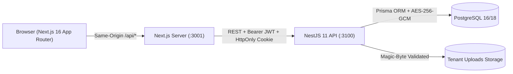

# TeduhHR — Indonesian HRIS & Payroll System

Sistem **HRIS & Payroll** end-to-end yang dirancang khusus untuk regulasi ketenagakerjaan & perpajakan Indonesia (**PP 58/2023 PPh 21 TER + Pasal 17**, **BPJS Kesehatan & Ketenagakerjaan**, **Lembur PP 35/2021**, **THR Permenaker No. 6/2016**), lengkap dengan perusahaan demo fiktif **PT Ruang Teduh Karya** (*Studio Arsitektur & Design-Build — Jakarta, Bandung, Bali*).

Dokumen desain:
- [PRD-HRIS-Payroll-System.md](PRD-HRIS-Payroll-System.md) — kebutuhan produk
- [ERD-Sistem-HRIS.md](ERD-Sistem-HRIS.md) — skema database
- [Payroll-Calculation-Engine-Detail.md](Payroll-Calculation-Engine-Detail.md) — rumus kalkulasi payroll

---

## Status Roadmap

| Fase | Ruang Lingkup | Status |
|---|---|---|
| **1** | Auth (Argon2id + MFA TOTP + Refresh Rotation), RBAC, Enkripsi Kolom, Audit Log Hash-Chain, Organisasi & Karyawan | **Selesai (API & UI)** |
| **2** | Absensi Geofence, Shift & Libur Nasional, Cuti & Saldo, Lembur, Multi-Step Approval Workflow & Notifikasi | **Selesai (API & UI)** |
| **3** | Payroll Engine Indonesia (Prorata, Lembur PP 35/2021, BPJS, PPh 21 TER & Rekonsiliasi Pasal 17) + Golden Tests | **Selesai (Engine & Tarif)** |
| **4** | Run Payroll Batch, Approval & Lock (*Separation of Duties* + DB Trigger), Laporan Biaya Departemen, Slip Gaji Digital (PDF) | **Selesai (API & UI)** |
| **5** | THR Prorata (Permenaker 6/2016), Reimbursement (2-Step Approval + Auto-Pay), Upload Bukti, Dashboard Analitik & Export CSV Finance | **Selesai (API & UI)** |

---

## Arsitektur Sistem



### Struktur Monorepo

```text
.github/workflows/ci.yml   CI otomatis: typecheck, build, unit test & E2E test (PostgreSQL)
apps/
  api/                     NestJS 11 + Prisma 6 + PostgreSQL
    prisma/                schema, 5 migrasi SQL (termasuk trigger DB), & seed demo hidup
    src/
      approvals/           workflow multi-step, delegasi, & unified pending inbox
      attendance/          clock-in/out geofence Haversine, shift, koreksi absensi
      audit/               audit log append-only dengan rantai hash SHA-256
      auth/                login, MFA TOTP, refresh token rotation, RBAC guard
      common/              enkripsi kolom AES-256-GCM, blind index HMAC, util tanggal
      employees/           karyawan, riwayat jabatan/gaji, komponen gaji
      leave/               jenis cuti, saldo tahunan, pengajuan & lampiran dokumen
      notifications/       notifikasi in-app real-time
      organization/        perusahaan, pengaturan kebijakan, departemen, jabatan, lokasi
      overtime/            pengajuan lembur & kuota mingguan PP 35/2021
      payroll/             pure calculation engine, tabel tarif, batch run, slip gaji, CSV export
      reimbursements/      klaim biaya operasional, 2-step approval, auto-pay ke payroll
      uploads/             upload & pratinjau foto/PDF terisolasi per tenant
      users/               manajemen akun user & role
    test/                  E2E test Fase 1 & Fase 2–5
  web/                     Next.js 16 + React 19 + Tailwind CSS v4 + TanStack Query v5
```

---

## Fitur Keamanan & Kepatuhan

- **Enkripsi per Kolom (AES-256-GCM)**: NIK, NPWP, nomor rekening, gaji pokok, nominal komponen gaji, rincian payroll, dan secret MFA dienkripsi dengan AAD per kolom dan versi kunci (`ENCRYPTION_KEYS`) untuk rotasi. Pencarian NIK memakai *blind index* HMAC.
- **Audit Log Append-Only + Hash Chain**: Ditulis dalam transaksi yang sama dengan perubahan data, dirantai SHA-256 (`GET /api/audit-logs/verify`), dan dilindungi trigger PostgreSQL agar tidak bisa di-`UPDATE` / `DELETE` / `TRUNCATE`. Akses data sensitif & export bank/NPWP dicatat sebagai `view_sensitive`.
- **Separation of Duties & Payroll Immutability**: Constraint database (`approved_by <> processed_by`) memastikan pemroses payroll (HR) tidak bisa menyetujui run miliknya sendiri; trigger database memblokir segala perubahan setelah periode berstatus `locked`.
- **Autentikasi Modern**: Password Argon2id, lockout 15 menit setelah 5 kali gagal, rate-limit login, MFA TOTP wajib untuk `super_admin`, `hr_admin`, dan `finance`, serta refresh token di cookie `HttpOnly; SameSite=Strict` dengan deteksi *token reuse*.
- **Upload Dokumen Aman**: Validasi *magic bytes* (JPG, PNG, WebP, PDF maks. 5 MB), regex nama file anti *path traversal*, dan isolasi multi-tenant per `companyId`.

---

## Menjalankan Lokal (Development)

Prasyarat: **Node.js 22+** dan **Docker Desktop** (atau PostgreSQL 15+ lokal).

```bash
# 1. Install dependencies monorepo
npm install

# 2. Nyalakan PostgreSQL (port 5433)
docker compose up -d

# 3. Migrasi, seed data demo, dan jalankan API
cd apps/api
cp .env.example .env
npm run db:migrate
npm run db:seed
npm run dev
```

Di terminal kedua dari root repo, jalankan frontend:

```bash
npm run dev -w @hris/web
```

- **Web App**: `http://localhost:3001`
- **API Health**: `http://localhost:3100/api/health`

### Akun Demo (PT Ruang Teduh Karya)

Password semua akun demo (default `SEED_DEFAULT_PASSWORD` di `apps/api/.env`): **`Demo-Hris-2026!`**

| Email | Role | Wajib MFA? | Akses Utama |
|---|---|---|---|
| `admin@ruangteduh.test` | `super_admin` | Ya | Akses penuh sistem, pengaturan perusahaan, verifikasi rantai audit |
| `hr@ruangteduh.test` | `hr_admin` | Ya | Karyawan, organisasi, absensi, cuti, lembur, buat & ajukan Run Payroll |
| `finance@ruangteduh.test` | `finance` | Ya | Verifikasi & Kunci Payroll, Laporan Biaya Departemen, Export CSV, Approval Reimbursement |
| `manager@ruangteduh.test` | `manager`, `staff` | Tidak | Persetujuan tim (cuti, lembur, koreksi, reimbursement), profil & slip gaji sendiri |
| `staff@ruangteduh.test` | `staff` | Tidak | Self-service absensi, cuti, lembur, reimbursement, & cetak PDF slip gaji |

> Seed otomatis mengisi data demo hidup: 16 karyawan, 6 departemen, 3 lokasi kerja (WIB & WITA), absensi hari ini, 3 batch payroll (Sep–Nov 2026), serta contoh pengajuan pending di inbox Persetujuan.

---

## Deployment Production (Docker)

Jalankan seluruh stack (PostgreSQL + API + Web) dalam satu perintah:

```bash
docker compose -f docker-compose.prod.yml up -d --build
```

Pastikan environment variable rahasia (`JWT_ACCESS_SECRET`, `JWT_REFRESH_SECRET`, `JWT_MFA_SECRET`, `ENCRYPTION_KEYS`, `HMAC_KEY`, `POSTGRES_PASSWORD`) sudah di-set di environment / `.env` server.

---

## Pengujian (Unit & E2E)

```bash
# Unit test & golden test payroll engine (10 suite, 53 test — tanpa butuh DB)
npm test -w @hris/api

# E2E test Fase 1–5 (2 suite, 13 test — butuh PostgreSQL yang sudah dimigrasi & di-seed)
npm run test:e2e -w @hris/api

# Typecheck & production build
npm run build -w @hris/api
npm run typecheck -w @hris/web && npm run build -w @hris/web
```
